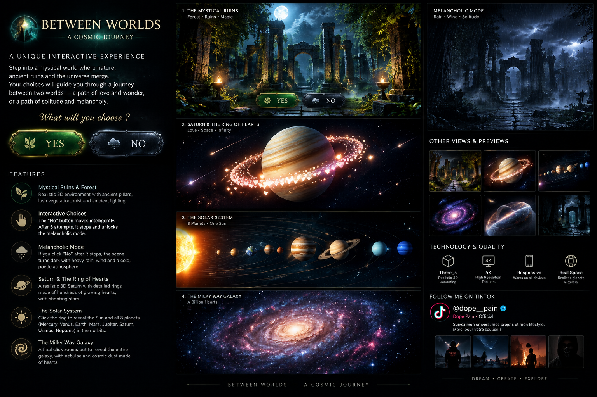

# Between Worlds — Realism Update

A Three.js interactive cosmic fable with the YES/NO choice, a melancholy rain scene, Saturn and a ring of hearts, the solar system, and a Milky Way finale.

## Visual preview



This is a concept showcase image, not a screenshot of the live page.

## What was improved in this build

- Reworked planetary procedural textures to add more broken, turbulent cloud belts instead of simple flat stripes.
- Higher-detail sphere geometry for Saturn and the solar-system planets.
- Added cloud-style textures for Venus, Uranus and Neptune, plus distinct Earth, Mars, Mercury and Jupiter maps.
- Layered Saturn rings with finer ring bands.
- Added a soft procedural nebula behind the space scenes.
- Improved the forest palette with darker bark, richer foliage, low ferns and scattered leaf litter.
- Preserved the existing YES/NO interactions, rain scene, story phases, progress indicator, and restart button.

## Story phases

1. **The Ancient Grove** — moonlit ruins, vegetation, moss and fireflies.
2. **The Melancholic Path** — cold rain, fog and lightning flashes.
3. **Saturn & the Ring of Hearts** — Saturn, layered rings, glowing hearts and shooting stars.
4. **The Solar System** — the Sun and eight orbiting planets.
5. **The Milky Way** — a spiral galaxy of colored star particles.

## Creator

**TikTok:** [@dope__pain](https://www.tiktok.com/@dope__pain)  
**Display name:** Dope Pain • Official

## Run locally

Serve this folder over HTTP (ES modules require a web server):

```bash
python -m http.server 8000
```

Open `http://localhost:8000`, or deploy the folder to GitHub Pages / Netlify. Three.js and Google Fonts load from external CDNs, so an internet connection is required.

## Important quality note

The scene uses procedural textures and WebGL rendering, not official NASA photographic maps. Rendering sharpness depends on the device, browser, screen and GPU; this is a visual upgrade, not a guaranteed native 4K render.
